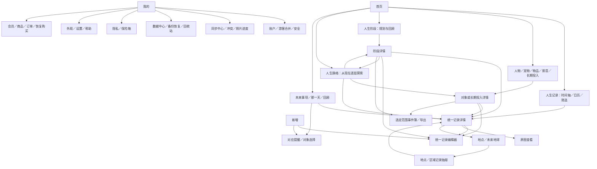
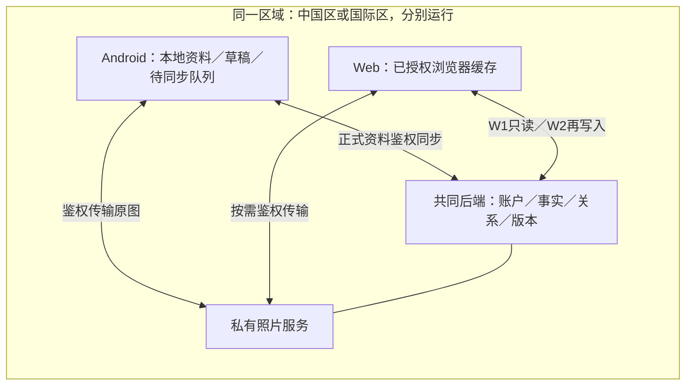

# Everhere 完整产品总规划 v3

日期：2026-10-20。本文是**面向产品、设计、开发和后续AI协作者的完整产品说明**：先解释产品是什么，再逐项说明所有规划功能的用途、操作、页面、资料关系和实施边界。产品规划版本独立于应用版本。

## 阅读说明

读完本文件，应能回答：用户为什么使用Everhere、能做什么、从哪里进入、各功能怎样协作、哪些已有、哪些尚未做。接手开发还需读取 [AGENTS.md](https://github.com/GLIMMER-He/Everhere_Android/blob/docs/life-stage-and-life-graph-20261020/AGENTS.md)、完整 [agent.md](https://github.com/GLIMMER-He/Everhere_Android/blob/docs/life-stage-and-life-graph-20261020/agent.md) 和 [当前交接](https://github.com/GLIMMER-He/Everhere_Android/blob/docs/life-stage-and-life-graph-20261020/docs/handoff.md)，核验最新代码与任务授权。

本文承接最初产品方案及后续决定，不是只解释人生阶段／脉络的局部补丁。当前功能与最终目标分开描述。标为“规划”的功能不是当前安装包的承诺；实现状态以第12节的基线、[功能矩阵](https://github.com/GLIMMER-He/Everhere_Android/blob/docs/life-stage-and-life-graph-20261020/docs/feature-parity.md) 和实际验收证据为准。本文不授予一次性开发整条路线、采购或部署的权限。

## 1. 这是什么产品，用户为什么需要它

Everhere（在场）是私人、本地优先的人生相册。用户把过去的经历、正在发生的生活与未来的期待留在同一处，保存文字和照片，联系相关人物、宠物、物品、地点与生活阶段，然后从时间、空间和关系三个角度回看自己的人生。

它既支持随手记下今天，也支持补录只记得年份的往事；既可以规划一段生活，也可以回顾实际经历。完整产品还会提供可逐步打开的人生脉络，帮助用户梳理“这些人、事情与时期怎样连在一起”。

产品面向希望长期保存私人生活资料、整理关系与回忆、跨设备回看的人。游客也能开始记录，使用云同步时再登录并授权。界面应温暖、精美、层次清楚，让记录和照片成为主体。

产品边界：不默认变成公开社交、聊天、通讯录、库存管理、通用任务管理或人生评分工具。AI分析、公开分享链接、音视频、实体书等不因规划留有扩展而自动进入承诺范围。

## 2. 全部功能地图

| 功能组 | 模块 | 主要解决的问题 | 详细说明 |
|---|---|---|---|
| 进入生活 | 首页、快捷新增、我的 | 今天从哪里看、从哪里写、从哪里管理？ | 4.1、4.2、4.22 |
| 记录生活 | 编辑、草稿、照片、日期与状态、统一详情 | 怎样可靠留下一次经历并继续完善？ | 4.2～4.5 |
| 按时间找 | 时间轴、日历、搜索筛选、回顾 | 怎样找回某一天、某个时期或某类经历？ | 4.6、4.7、4.15 |
| 按关系找 | 人物、宠物、物品、地点、工作、影音 | 与谁、与什么有关，有哪些共同经历？ | 4.8～4.11 |
| 规划与梳理 | 人生阶段、长期投入、人生脉络 | 一段生活怎么过，长期经历怎么发展，整个人生怎么连接？ | 4.12～4.14 |
| 按空间找 | 地点列表、未来3D地球 | 在哪里经历过，哪里还想去？ | 4.10、4.16 |
| 面向未来 | 计划、那一天、提醒 | 未来期待什么，什么时候提醒？ | 4.3、4.15 |
| 身份与多端 | 账户、游客合并、同步、冲突、换机、Web | 怎样记住用户，并在手机和电脑看到同一份资料？ | 4.17、4.18、第8节 |
| 资料安全 | 隐私、保险箱、备份恢复、回收站 | 怎样不丢资料、不串号、不泄漏，并能带走？ | 4.5、4.19、4.20 |
| 表达与个性 | 事件簿／分享、主题、设置帮助 | 怎样整理输出，调整外观并理解产品？ | 4.21、4.22 |
| 商业与运行 | 会员支付、容量、支持和运营 | 怎样购买可用能力，并长期可靠运行？ | 4.23、4.24 |

这些功能围绕同一份资料协作，不是互相独立的小应用。完整路线分批实现，详见第12节。

## 3. 产品里的资料分别是什么

| 概念 | 通俗解释与例子 | 与其他资料的关系 |
|---|---|---|
| 人生记录／事件 | 一次经历或计划，如“与小林去札幌滑雪” | 一条记录可关联多个对象、阶段、长期投入与多张照片；技术模型LifeRecord |
| 日期与状态 | 什么时候、是否已发生，如2024年12月、正在进行、计划中 | 决定时间展示及筛选，不等同录入日期、会员或隐私状态 |
| 照片资源 | 记录中的图片及顺序 | 原图、缩略显示和传输状态分开；技术模型MediaAsset |
| 人物与对象 | 生活中的人、宠物、物品、地点、工作或影音作品 | 通过关系连接事件；同名可为不同对象；技术模型LifeEntity |
| 人生阶段 | 用户定义的一段生活，如“留学时期” | 用于规划和回顾；可重叠、关联多个事件与长期投入；技术模型LifeChapter |
| 长期投入／旅程 | 围绕同一件事持续发展的经历，如“学习摄影” | 可跨多个阶段、汇集多次事件；旧模型LifeThread，界面最终名称待定 |
| 人生脉络 | 查看和整理上述内容关联的关系网 | 是探索方式及关系投影，不等同LifeThread，不新建一份事件正文库 |
| 提醒 | 用户希望在某时得到提示的意图，如生日提醒 | 可以指向对象或记录；触发提醒不等于经历发生；技术模型LifeReminder |
| 账户与游客空间 | “资料属于谁” | 每个区域、游客／账户相互隔离，资料归属不取决于昵称或设备名 |

一条记录保存一次即可在多个地方看到。时间轴、日历、地点、人物详情、阶段和脉络是同一份资料的不同入口。修改原记录后各处一致更新；解除某个人的关联不会删除原记录。

## 4. 每个功能具体做什么

以下“功能”描述完整目标；每节末尾单独标明当前程度。基本规则相同：未实现入口不放假按钮，读取失败不当作空资料，用户输入与已有资料受到保护。

### 4.1 首页：日常使用的起点

**用途：** 让用户快速看到自己的生活内容，并直接开始记录或回看。

**主要内容与操作：** 有照片的近期记录、最近编辑、正在进行和未来计划、草稿入口、当前资料范围的简明概况、账户状态。点击记录进入原详情；点击统计或类别进入真实筛选结果；点击新增进入编辑器。阶段、脉络等随实现逐步开放入口。

**关系：** 首页读取记录、草稿和账户状态，不保存第二套首页记录。摄影内容、层次与卡片是重点，不能退化成大段工程说明和大型统计按钮堆叠。隐私过滤后再计算可见数量。

**当前：** 已有首页及核心视觉改造；最终手机体验和全部页面一致性仍待收尾。

### 4.2 新增、编辑与草稿：把经历留下来

**用途：** 在断网、写到一半或被打断时仍能继续记录。

**主要操作：** 填标题／正文，选日期和状态，添加照片，关联对象、阶段或长期投入，补地点、心情标签及显示偏好。完整路线保留六类创作入口：已完成、进行中、计划中、那一天、影音、萌宠；后三类随对应模块上线。“那一天”进入提醒设置，影音／萌宠先选对象再写经历。

**页面：** 新增类型选择 → 统一编辑器 → 关联选择／照片选择／地点选择 → 保存 → 原记录详情或来源页面。人物、物品、阶段、长期投入本身在相应资料页创建，不能把创建对象和写经历混为一步假保存。

**关系和边界：** 从人物或阶段进入新增时预填相应关系；编辑保持原记录ID。自动／手动草稿支持恢复、继续和放弃；返回时保护内容，失败留输入，重复点击不重复创建。草稿不计正式记录，也不默认上传或跨端。

**当前：** 已有文字、多图、基础人物关联、草稿与同ID编辑；完整模块字段和六入口按批次补齐，不能声称所有编辑能力已完成。

### 4.3 日期、经历状态与未来计划：描述生活发生的时间

**用途：** 支持精确日、只记得月／年、一段时期或日期未知的真实生活，而不是强制每条都是今天。

**主要操作：** 选择日、月、年、范围或未知；选择已发生、进行中、计划中，并按业务区分完成／取消等进展。计划日期待定可保留，计划成为实际经历时确认真实日期，保持原ID而不是复制一条已完成记录。

**日期帮助：** 当前编辑草稿没有明确日期时，可用所选照片的有效拍摄日帮助填写；已有明确输入优先。照片没有日期时继续原系统日期候选。打开空日期弹窗可预选系统当天，取消不提交；自动候选不等同用户确认的真实经历日期。

**关系：** 时间轴、日历、筛选、往年今天、阶段与地球复用同一日期语义。事件日期与系统创建／修改时间分开，年／月不伪造具体日；拍照日也不永远等同事件日，用户可以修改。

**当前：** 已有基础日期精度、状态与点击选择，以及code24／25日期帮助；提醒和完整周期事件仍是后续范围。

### 4.4 照片与原图：让相册有可回看的内容

**用途：** 给经历添加照片，保留原始图片与排序，支持大图回看及恢复。

**主要操作：** 通过系统选择照片、加入记录／草稿、调整或维护顺序、移除关联、详情浏览、放大与前后切换。读取失败提供解释与重试；取消选图不改变原有输入和照片。正式保存前的照片属于编辑上下文。

**关系：** 照片使用稳定资源ID，由记录引用；端内副本受私有存储和加密保护。记录中的移除、资源物理回收、云端删除分别处理，不能误删其他仍引用图片的记录或手机相册原件。

**跨端：** 文字同步、照片元信息、原图上传和另一端下载分别显示状态。电脑不读取手机本地路径，也不靠复制手机密钥解密。

**当前：** 本机照片及受控本机服务原图传输已有实现／证据；当前包公网链路、完整手机验收仍未交付。此前选图取消的自动检查问题保留，未声称解决。

### 4.5 统一详情、编辑、删除与回收站：所有入口回到同一事实

**用途：** 完整查看一次经历，并安全修改或撤回删除。

**主要内容与操作：** 正文、事件日期及状态、照片、地点、关联人物／对象／阶段／长期投入；进入原编辑器、原图、关联资料或地点。已上线功能才开放按钮。

**关系：** 不论从时间轴、日历、人物、脉络或地球进入，都按同一记录ID读取。编辑后所有视图刷新；删除后不继续展示旧快照。常规删除为软删除，回收站负责已支持记录的恢复；恢复须遵守关系与同步删除规则，不能自动复活另一端明确删除的旧数据。

**边界：** 解除对象关系不等于删除记录；清理本机缓存、彻底删除资源、注销账户也不是同一个动作。永久删除的范围、确认和资源回收要在实际支持的批次明确，不能暗中代替用户选择。

**当前：** 核心详情、同ID编辑与记录删除／回收已有；未来类型的专属详情和完整关系操作继续分批完善。

### 4.6 人生记录：时间轴与日历

**用途：** 按时间顺序或某一天回看生活，切换观看方式而不切换数据库。

**时间轴：** 显示经历与照片摘要，按事件日期组织，区分进行中、计划、已发生和日期待补充；点击进入原详情。

**日历：** 翻月、跳到指定年月、选择某日、查看对应事件；从选日新增时带入日期。年／月精度和跨期范围不能当成某个精确日来统计，不把所有范围日都算作实际打卡。

**关系：** 同一筛选条件下共用查询逻辑和日期规则；日历按选日进一步取合适子集。列表切视图、进详情再返回，应保留月份、筛选、选日与位置。

**当前：** 已有本机时间轴／日历／跳月／日期筛选，仍需当前手机整体试用。

### 4.7 搜索、筛选与统计：可靠找到资料

**用途：** 从大量记录中找标题／正文相关内容，或某个状态、日期、人物与地点的经历。

**主要操作：** 关键词、时间范围、状态、日期精度及已支持的关联条件组合筛选；清除筛选；从统计进入对应结果。对象等新增类型的筛选随其上线补齐，不显示无法执行的选项。

**关系：** 搜索结果、时间轴、日历、对象相关记录和未来地球尽量共用查询规则；地球另加合法坐标和展示开关，不能假装空间结果包含所有记录。

**边界：** 记录数量按稳定ID去重；资料数量不是用户价值或人生分数。空档案、筛选无结果、读取失败分别解释。锁定保险箱内容不进入搜索、摘要、数量或索引。

**当前：** 已有基础记录搜索／筛选和统计入口；高级回顾、完整关系筛选仍属后续。

### 4.8 人物：围绕一个人回看共同经历

**用途：** 不只记一个名字，而是看见与这个人有关的生活。

**主要操作：** 创建人物、同名区分、资料编辑、搜索；人物详情展示已关联记录，从“与TA记录”新增时带入人物关系。完整资料可逐步支持封面、介绍和意义等已定义内容，不能把模型中的字段视为已上线页面。

**关系：** 一个人关联多次事件，一次事件可关联多人；从人物详情进入同一记录。人物也能出现在阶段和脉络中，关系是否直接存在须明确来源。

**边界：** 昵称不是主键，同名不自动合并；删除人物或解除关联保留原事件。不是聊天或未经授权导入整本通讯录的入口。

**当前：** 基础人物创建、编辑、关联和聚焦已实现；完整关系网尚未做。

### 4.9 宠物与物品：保存生活中的陪伴与意义

**宠物用途及操作：** 建立宠物档案，记录名字、品种等资料，区分生日与到家日，回看成长、陪伴及相关照片；写一条宠物经历仍走统一记录编辑器。离开、离世或阶段结束不删除历史档案。

**物品用途及操作：** 为有意义的相机、礼物等建档，写来源、介绍与意义，关联旅行、赠送、使用等经历。物品的存在时间与某次事件日期分别表达，不默认成为库存／购物管理系统。

**页面：** 对象分类列表 → 宠物／物品详情与相关记录 → 资料编辑或新增经历。

**关系：** 同一宠物或物品可以跨多个阶段、连接多个人和事件，进入脉络时引用原对象ID。删除资料只按规则解绑，不连带删除经历与照片。

**当前：** 模型有类型预留，不代表宠物／物品完整业务已实现；属于后续关系完善。

### 4.10 地点与工作等其他对象：保留生活背景

**地点：** 记录地点名称与可选坐标，按地点查看相关事件；文字地点也能保存，没坐标不装成精确GPS。未来“去过／想去”依据已发生／计划区分。地点聚焦和地球读取同源资料。

**工作／自定义对象：** 表达某段工作背景或经用户定义的生活对象，并关联经历。旧work表示工作，media才是影音，不能为改名称把历史含义改掉。复杂专属工作流没有因类型存在而被承诺。

**页面与关系：** 地点列表／对象列表 → 相关记录或对象详情 → 原记录。真正的导航、天气和实时位置属于另行定义能力，不照搬参考图假按钮。

**当前：** 已有记录地点、空间查询和地点列表契约；精细对象档案、实际定位服务等按后续范围核验与实施。

### 4.11 影音：把作品与自己的经历连接

**用途：** 留下“我与一本书／一部电影的经历”，而不只列作品目录。

**主要操作：** 分类管理书、电影、剧、游戏、音乐或演出，记录创作者等资料、个人状态／评分及意义；选作品后写观看、阅读或参与经历，支持多次回看同一作品。

**关系：** 作品资料是对象，阅读或观看是LifeRecord。作品上映／出版日与个人体验日期、作品状态与事件进展分开。可关联同伴、地点、阶段与长期投入；主时间轴是否显示尊重记录设置与新建默认。

**边界：** 外部评分、封面和介绍需来源与使用权，不凭空编造；没有外部服务仍可保存个人资料。

**当前：** 规划功能；作品模型预留不等于已上线影音库。

### 4.12 人生阶段：规划一段生活，并回顾后来发生了什么

#### 用户可以做什么

- 自己命名并划分阶段，例如“大学时期”“初到上海”“与小橘一起生活”。不强制年龄模板或互斥分段。
- 记录开始、结束或仍在持续的时间信息，允许未来阶段与日期待补充；保留日期精度，不伪造具体日。
- 写下该时期的期待、方向、想经历的事情；关联计划记录和已有经历。规划不自动变成已发生事实。
- 回顾实际发生的事情、重要人物与对象、收获与变化，写自己的阶段总结。
- 从阶段进入相关记录详情，也可“在脉络中查看”该阶段及其邻近关系。

#### 页面及规则

阶段列表 → 阶段详情（规划、相关经历、回顾）→ 编辑／选择关联／在脉络中查看。

阶段可重叠，一条事件可属于多个阶段；只更改阶段日期不自动重分所有事件。可建议时间范围内候选记录，正式归属由用户确认。删除阶段需说明仅解除关系、保留原事件；未保存内容按草稿保护。

规划与回顾是独立语义，不用一个随意拼接的正文冒充完整能力。现有 LifeChapter 字段能否承载这些内容，实施时核验，必要时追加兼容迁移。本次不声称已经存在相应字段或页面。

**与其他功能的关系：** 阶段中的“去滑雪”可以是计划记录；发生后在同一记录确认实际日期和状态。阶段总结引用已发生经历，不能把规划自动当完成。阶段在脉络中是一个节点，但阶段详情本身必须提供规划和回顾能力。

**当前：** 完整阶段功能尚未实现，后续B2分批；LifeChapter表或同步契约存在不是完整功能交付。

### 4.13 长期投入／旅程：串起一件事持续发展的经历

**用途：** 回看“学习摄影”“练习滑雪”等持续发展的事情，允许暂停、转向或结束，不用任务打卡判断人生是否成功。

**主要操作：** 建立名称、时间、意义或总结，维护计划／进行／暂停／完成／转向／结束等合理状态，关联多次事件，查看发展过程，从容器内新增时预填关系。

**区别：** 阶段关心“一段生活时期”，长期投入关心“持续的一件事”；长期投入可以跨阶段，一个阶段也可以有多个长期投入。人生脉络把它们和其他内容连起来，不等于长期投入列表。

**页面：** 列表 → 聚焦详情 → 编辑／关联记录／新增经历／在脉络中查看。最终界面名称待确认；保留旧LifeThread数据含义，不静默改表或重写历史字段。

**当前：** 旧模型及部分协议有预留；完整容器业务和页面尚未交付。

### 4.14 人生脉络：由用户逐渐打开并梳理的一生关系网

#### 核心体验（用户已确认）

第一次进入定格到“现在”，只展示有限的相关内容，不一次展开全部人生。用户自己滑动浏览、选择焦点、整理关系，一点一点打开这张网。

“现在”是进入生活的时间锚点，不是强制所有节点围绕它的永久根节点。用户可以围绕某个人、宠物、阶段或事件重新聚焦，再探索更早或更远的经历。

阶段、事件、人物、宠物和物品都能出现在同一关系网中。时间轴用于按时间排列，人生脉络用于看关联；两种视图读取同一事实，可以互相跳转。

#### 建议的交互方案（实现前用代表画面确认）

1. 初始显示“现在”、当前相关阶段和少量近期／进行中的事件及关联对象。近期窗口、数量上限和排序应在原型中明确，不把“最近更新”误当人生重要程度。
2. 滑动／拖动平移，缩放查看局部；提供无需精细手势也能完成操作的列表或关系说明。
3. 点选节点先看摘要、关系与展开入口；点击“展开关联”加载一层相邻内容，不递归展开所有后代。
4. 展开后保留焦点和方向感；可收起本次分支、切换焦点、筛选节点类型或时间、回到现在。
5. 点进原详情后返回，保留当前焦点、展开层级、筛选与视口。再次打开优先提供“回到现在”；是否自动恢复上次视口由后续交互确认。
6. 节点多时分批／按需查询，并明确“还有关联可展开”；无法读取与没有关系分别提示。

收起分支只改变视图；共享节点仍被其他已展开路径引用时可保留。平移或移动卡片不能隐式建立关系，也不能改变事件日期。用户手动摆放节点属于可选呈现能力，是否持久化和跨端共享待原型确认。

#### 关系如何产生

- 复用已经由用户保存的事件—人物／宠物／物品、事件—阶段、事件—长期投入等正式关系。
- 用户可主动选择两个对象及有明确含义的关系类型，并查看、修改、解除关系；需要新关系类型时先确定语义、方向、日期范围与兼容方案。
- 系统可把相同时间范围等作为候选建议；未经确认的推测不写成正式关系。只因为共同参与事件，不自动判定两个人亲密、存在因果或某事件改变人生。
- 展示关系的来源：用户直接关联、某条记录支持的间接路径、待确认建议。间接路径不能画成已经存在的直接关系；删除支持记录后应重新计算派生路径。
- 若允许用户标记“影响／转折”等解释性关系，应清楚表明这是用户的整理，并非系统认定的客观因果。

关系变更与画布操作分开，解除关系不得删掉原事件、人物或照片。重复路径与环路允许存在，展开必须去重并保持稳定 ID，不变成无限递归树。

#### 示例体验

从“现在”看到“大学时期”和“毕业项目”；展开“毕业项目”，看到同组人物、相关事件与一件相机；聚焦相机，再看到旅行和摄影经历；展开某段旅行，回到更早的阶段。每次只打开用户选择的一部分。

宠物可以跨多个阶段陪伴；一件物品可以连接多次旅行；一个事件可以连接多个阶段和人物。离开、结束或删除一条关系不抹掉过去经历。

示例均为说明交互的合成内容，不属于当前应用已实现数据或真实个人资料。

**页面：** 脉络画布 → 节点摘要／关系来源 → 原事件、阶段或对象详情；显式关联编辑与拖动画布分开。

**当前：** 已确认产品方向，尚未实现；后续B2先局部浏览，再补主动整理与更多关系。具体手势／数量／布局以代表画面确认。

### 4.15 那一天、未来事项、提醒与回顾：在时间里再次遇见生活

**那一天：** 集中回看往年今天和用户设置的纪念日期；往年今天指向真实旧事件，纪念日提醒是独立意图，不能为了凑内容生成假经历。

**未来事项：** 展示计划和待安排事件，进入同一详情继续编辑。计划可以改期、取消或确认发生；不会仅因日期过去就自动标为已完成。

**提醒：** 规划支持一次、周期或“经过多久”等提醒规则，关联对象或记录并通过系统通知回到对应页面。修改或删除须取消旧任务；拒绝通知权限仍保留资料并解释不通知。闰日、时区、跨设备重复通知和重新调度在实施时明确。

**数据回顾：** 按周／月／年／自选时期查看真实记录及可解释统计，点击图表或数量回到对应记录；与阶段回顾区分，后者包含用户主动规划和文字总结。无打卡分数、虚构天气或无来源人生评价。

**当前：** 基础计划记录和未来入口已有；完整那一天、通知调度及高级回顾尚未完成。

### 4.16 地球与空间浏览：从地点回看人生

**用途：** 看见经历在空间里的分布，以及未来想去的地方。

**最终操作：** 旋转和缩放真实3D地球，按国家／区域／具体坐标分层与聚合；点击点位或区域打开记录抽屉，再进统一详情；按状态、时间等筛选。定位自己是单独授权的操作，回看已有地点不要求实时定位权限。

**关系：** 读取LifeRecord中的合法位置与显示开关；记录按原ID打开，地球没有独立日记库。计划地点与已发生足迹区分，缺坐标保留文字地点，0坐标合法，不能随便猜点位。用户可以从详情聚焦到相应位置。

**主题与状态：** 地球材质、背景和样式可换，但不能重建事实、丢选择或重置姿态。离线资源、命中／背面遮挡、性能和手机手势须实际验收。

**当前：** B1保留地点和空间查询，3D渲染按B3；静态图片不是地球功能。

### 4.17 账户、身份与游客资料：记住的是用户，而不是这台手机

**用途：** 保持资料归属，让同一区域的用户再次登录或换设备后找回已同步内容。

**完整流程：** 游客开始记录 → 注册／邮箱验证 → 登录 → 预览本机游客与账户资料 → 用户选择加入或稍后 → 会话恢复和同步。支持找回密码、退出、换号、会话撤销和注销。手机号或第三方登录是候选扩展，不冒充现已接入。

**怎样记住用户：** 后端分配稳定userId，邮箱和昵称改变不换主人；手机保存受保护的会话以恢复登录。资料按区域＋归属隔离，设备标识用于区分设备而非充当所有者，不能靠邮箱字符串或客户端传owner授予权限。

**游客合并：** 先展示数量、照片、冲突和排除范围，再明确确认；选择稍后继续保留本机资料而不偷偷上传。同名不同ID不自动合并，受保护资料按已支持边界处理。换号先取消旧任务、清敏感画面和缓存，A资料不能进入B。

**当前：** 账户、会话、合并和后端代码及受控本机验证已有；基线展示包未接可用公网服务，不能宣称注册收信／登录／找回／同步已供用户完整体验。

### 4.18 同步、冲突与换机恢复：让正式资料跨设备保持一致

**用途：** 本机先保存，联网后可靠发送，换机时恢复云端资料；同步不会替代本地保存。

**用户操作：** 同步中心看文字／关系、照片的独立进度及失败原因，手动重试，处理冲突。后台只在当前账户、授权和环境满足时执行。同步成功必须来自服务真实确认，不是点击按钮后的提示。

**冲突：** 两端都编辑时可保留本地、采用远端、保留两份或手动合并；选择前复核版本，失败保留输入，只有保留两份才新建副本ID，普通编辑仍为原ID。删除传播与离线旧编辑也须处理，不按设备时钟或最后上传直接覆盖。

**换机：** 同区账户登录后恢复事实、关系与资源元信息，再下载照片；明确还有多少原图没恢复。游客、未上传资料与默认端内草稿不能承诺云端找回；原图缺失不伪装完整。

**当前：** 已有持久队列、调度、真实受控服务请求、四种冲突、私有原图和双Android恢复证据；生产／公网服务及当前用户手机闭环仍待实施和验收。

### 4.19 隐私与保险箱：私人不等于公开，登录不等于解锁

**基础隐私：** 所有普通人生资料默认私人，使用区域／账户授权、数据库与照片保护、缓存清理和最少权限。游客与每个账号隔离；导出和分享是单独授权。

**保险箱目标：** 独立PIN／生物识别、自动锁定和后台保护；锁定后正文、图片、搜索、统计、封面、地球点、关系网节点／边／数量和通知都不能泄漏。账户登录与密码找回不能代替保险箱解锁或恢复密钥。

**关系：** 保险箱是保护范围和能力，不是把同一事件复制到另一套业务系统。默认不参与普通云同步；可选云恢复须另行设计端到端密钥、恢复与丢失策略。未实现时不能接收保护内容后当普通记录保存。

**当前：** 本机普通资料加密／隔离已有；完整保险箱未实现，不开放假开关，受保护导入按明确拒绝边界处理。

### 4.20 导入、导出、完整备份与恢复：让资料可以带走

**用途：** 从受支持旧格式迁入，导出自己的资料，并在独立安装恢复记录、关系和照片。

**用户操作：** 在数据中心选择JSON或含原图ZIP；查看预览中的数量、重复、冲突、缺图和不支持项，再确认恢复。重复不重复创建，有冲突按已支持策略明确处理；存储失败／取消保留可重试状态，不能提前报保存成功。

**区别：** JSON是结构化资料导出，明确无原图；完整ZIP包含资料、照片和校验清单。同步是让设备共享变化，误删也可能传播；独立备份是某时点的可恢复副本，二者不能互相冒充。恢复到账号是否同步另行确认。

**关系：** 保留原记录／对象／关系ID、日期、照片顺序和原字节；目标重新加密，不导入旧设备凭证、路径或密钥来取得权限。新增阶段和脉络关系上线时须同步升级备份格式及兼容，不静默丢关系。

**当前：** B1-07普通资料JSON／ZIP和独立恢复已有验收；旧复杂富媒体／图谱、保险箱等不支持内容会明确拒绝，不宣称任意旧备份都能恢复。

### 4.21 事件簿、局部导出与分享：整理一部分人生给自己或他人看

**用途：** 把一段阶段、某个人、一次旅程或选定事件整理成可阅读的内容，而不交出整个账户。

**主要操作：** 选择范围和记录，调整标题／呈现／是否含图，预览并确认输出；完整路线包含Markdown／HTML事件簿及待补齐的PDF／图片输出，再通过系统分享或保存。

**关系：** 从阶段、人物、长期投入或记录筛选进入，复用原事件和授权照片，导出的是选定副本。事件簿不是原始数据库备份，也不能承诺一键重新导入成完整档案。

**边界：** 默认去除不需要的敏感字段，保险箱须独立授权。公开网络链接、永久云分享、实体书未因系统分享而自动加入。格式、模板、图片体积与字体许可按实施细化。

**当前：** JSON／ZIP数据工具已有；完整事件簿／排版／PDF图片输出仍属后续，不混为B1已完成导出。

### 4.22 我的、外观、设置与帮助：统一管理产品

**我的：** 汇集账户、安全、同步、数据备份、回收站、会员／订单、主题、设置和帮助。只显示当前可用入口；缺服务时可解释账户功能状态，不把登录藏到用户无法理解。

**外观：** 保留WARM／FOREST；统一背景、正文、操作色、字号、间距、圆角和卡片。完整路线可增加主题预览／应用／下载／恢复默认，付费主题的购买资格与当前主题分开。主题下载失败保留当前外观，换主题不改资料或清空草稿。

**设置帮助：** 默认显示与通知偏好、隐私与协议、功能说明、备份解释、版本、支持／反馈方式。设备权限拒绝提供合理说明。清本机、退出和注销各自写清影响，不放含义不明的“清空一切”。

**可访问性：** 小屏大字、足够触控区、可读对比与文字标签；状态不只靠颜色，关系网提供可访问替代操作。所有页面沿用统一组件和导航规则。

**当前：** 两主题、部分设置帮助和核心视觉已有；下载主题／付费主题未实现，最终手机排版和全局一致性仍待收尾。

### 4.23 会员、支付、购买恢复与容量：解锁已经可用的能力

**用途：** 为有持续成本的云服务或明确高级能力提供可理解、可恢复的购买方式。

**建议商品，尚未定价：** 云会员、明确期限／额度的照片容量、高级主题或事件簿模板等单项商品；不默认建立充值钱包。免费云额度、哪些能力收费、价格与保留期限在正式商业批次前确定，不能把建议当已承诺套餐。

**完整操作：** 查看可用商品与实际报价 → 登录并确认购买归属的区域账户 → 渠道付款 → 后端核验 → 幂等发放权益 → 刷新能力并返回原操作。包括取消／待支付／已扣款待核验、订单查询、失败重试、恢复购买、续费／取消／到期／退款。

**怎样跨设备记住购买：** 权益绑定区域userId而非某台手机；订单记录付款事实，权益决定可用能力，两者分开。主题样式不改变会员。国内渠道／商户主体待定，国际路线默认适配Play；实际接入前核查当时渠道规则，不擅自采购或写死价格。

**边界：** 只销售已可用能力。到期／容量超额不能锁住用户已有资料的查看、导出和删除，不立即删本机图片；新云上传及保留策略须事先明确。注销不等同取消商店续费，需提供管理指引。

**当前：** B2规划，没有已上线商品、支付或权益闭环。

### 4.24 后端、支持与运营：保证完整流程能长期运行

**共同后端职责：** 正式身份认证和会话、按用户授权的事实与关系同步、私有照片传输、后续商品订单／权益、主题目录及账户删除。客户端不能凭自己说“已登录／已付款”取得权限。

**完整运行条件：** 区域独立服务与数据库／私有资源、手机可达的服务地址、域名／HTTPS、真实验证及找回邮件、必要监控和服务器备份恢复。开发本机联调、可供手机访问的测试服务和生产服务是不同交付。

**运营与支持目标：** 区域隔离和员工权限、审计、订单／失败履约支持、同步与照片任务故障、资源容量、注销任务和服务健康；支持访问不能默认翻看所有私人正文。

**当前：** Node.js／TypeScript后端及PostgreSQL迁移已有代码和本机记录；正式部署、真实发信和完整运营能力未交付。域名、供应商、预算与部署须集中列出由用户决定，不自动购买。

## 5. 页面怎样组织、用户从哪里进入

### 5.1 Android导航

最终一级导航延续：首页／人生记录／新增／地球／我的。B1空间位使用可用地点列表，或按实际版本隐藏未完成入口；时间轴与日历在人生记录内部切换。编辑器和全屏原图聚焦当前任务，可隐藏底栏。

人物、对象、阶段、长期投入和人生脉络从首页或相关资料入口进入；阶段与脉络必须能区分，具体摆位在原型确认，不擅自增加第六个底栏或让各页面换一套主导航。

此图表达完整目标，未上线节点不因此成为当前可用页面。逐页来源、参数、返回和失败处理见 [页面契约](https://github.com/GLIMMER-He/Everhere_Android/blob/docs/life-stage-and-life-graph-20261020/docs/page-contracts.md)。

### 5.2 全页面共同规则

列表进详情返回保留筛选和滚动；日历保留月份和选日；脉络保留焦点、展开与视口；地球保留旋转／缩放和选择。跨页传稳定ID，不传一份能各自修改的正文副本。

所有页面区分加载、有内容、首次空态、筛选无结果、离线、失败、无权限与已删除。保存页保护草稿与失败输入；支付页区分取消、待付款、扣款待核验和已恢复。没有实现或缺服务时解释限制，不能假成功。

### 5.3 Web布局

电脑采用适合大屏的导航、列表与详情布局，复用资料语义，不机械放大手机底栏。只读版本不显示写入按钮；未来编辑版才提供新增、关系整理和草稿。网页具体页面按W0／W1／W2及已成熟功能逐批开放。

## 6. 功能之间真正共享的关系

### 6.1 资料关系

| 两类内容 | 关系是什么 | 用户能够获得的结果 |
|---|---|---|
| 记录 ↔ 人物／宠物／物品等 | 多对多，用户明确关联 | 从事件看参与对象，从对象看共同经历 |
| 记录 ↔ 阶段 | 多对多；阶段允许重叠 | 在某时期规划和回顾相关经历，不按日期强制归属 |
| 记录 ↔ 长期投入 | 多对多 | 一次旅行可同时属于摄影和学习语言等投入 |
| 阶段 ↔ 长期投入 | 多对多，沿用兼容关系 | 一个投入可跨时期，一个时期也可有多个投入 |
| 记录 ↔ 照片 | 多个有顺序的资源引用 | 详情／列表／导出／多端指向同一资产，而非各存一份事实 |
| 记录 ↔ 地点信息 | 记录带地点，必要时明确关联地点对象 | 按地点查询，合法坐标再进入地球 |
| 提醒 ↔ 记录／对象 | 提醒引用目标，非新增实际经历 | 通知回原页面，修改／删除取消旧调度 |
| 人生脉络 ↔ 上述资料 | 将授权事实与关系形成局部可展开网络 | 逐层发现关联并进入原详情，不生成第二人生档案 |

阶段—对象或其他任意直接关系不因为能画线就自动存在。现有资料能推导的间接路径、用户确认的直接关系和系统建议分开；新类型在实施时设计迁移、方向、来源、冲突及导出。

### 6.2 五种回看方式的区别

| 方式 | 核心问题 | 不应承担的职责 |
|---|---|---|
| 时间轴／日历 | 什么时候发生？ | 不为展示复制事件 |
| 地点／地球 | 在哪里发生？ | 不把无坐标记录伪造为点位 |
| 人物／对象／长期投入详情 | 围绕谁或什么发生？ | 不成为互相孤立的日记库 |
| 人生阶段 | 那段生活怎么规划、实际如何？ | 不只做日期筛选标签 |
| 人生脉络 | 不同经历、时期和对象怎样联系？ | 不等同线索列表，不一次全量展开，不猜测因果 |

### 6.3 横跨所有功能的系统

| 系统 | 管什么 | 与其他系统的边界 |
|---|---|---|
| 身份／归属 | 谁能读写哪份资料 | 登录不自动解锁保险箱，也不等同会员 |
| 隐私 | 当前能显示哪些正文、图片与关系 | 先过滤再搜索／计数／出图，不靠只隐藏卡片保护 |
| 本地保存与同步 | 可靠落盘、跨端版本与恢复 | 保存不等待网络，云端成功和照片完成分开 |
| 功能可用性 | 本版本／区域／测试范围开放什么 | 开关不能把不存在的功能变成已实现 |
| 购买权益／容量 | 账号能使用什么付费能力及额度 | 商品、订单、权益、当前主题分别管理 |
| 主题／布局 | 如何呈现内容 | 换美术不修改事实、归属、同步或购买规则 |

## 7. 用一段完整生活看功能如何串起来

以下为说明产品的合成例子，不是当前已交付全流程。

1. **先规划：** 用户建立“留学时期”阶段，写期待，关联“学习摄影”长期投入和“去札幌滑雪”计划。
2. **实际记录：** 滑雪时新增或更新同一计划，确认实际日期，写正文、添加照片，关联小林、相机及地点；断网先存手机。
3. **多处回看：** 时间轴出现这条事件，日历对应日期可查，小林／相机／摄影／阶段详情都通过原ID找到它；未来地球显示合法位置。
4. **梳理脉络：** 从现在进入当前阶段，逐层展开摄影、相机、这次旅行和小林；选节点查看原详情，返回继续探索。
5. **回顾与输出：** 阶段总结比较原期待和实际经历，选择部分事件生成事件簿；不是把计划全算成完成。
6. **跨设备：** 用户确认资料加入同区账号，文字与关系同步后电脑可见；原图未上传则明确缺图，手机无需一直在线。
7. **继续完善：** 电脑未来编辑版修改原记录，手机按版本拉取；并发修改保留冲突，不直接覆盖。
8. **安全带走：** 做含原图ZIP备份，在新安装恢复同ID与关系；解除小林关联保留旅行，换号不会看到原账号资料。

另一个日常最短路径是：游客打开 → 写一条文字／加照片 → 离线保存 → 重开找到 → 日后再登录。用户不必先整理整个人生才能开始。

## 8. 账户、区域、手机和Web怎样连在一起

### 8.1 两个区域，各自一套共享服务

中国区与国际区共用产品与核心协议，但账号、资料、数据库、资源、订单、权益、密钥和运营配置独立。同邮箱在两区也是独立账户；不依语言、IP或临时开关偷偷搬家。

同一区域Android和Web共用userId、记录／对象／阶段／资源ID及正式关系，使用共同后端同步。手机与电脑都有自己的本地副本和设备标识，不直接互读本地数据库，也不要求手机一直在线。

### 8.2 哪些能互通，哪些不能默认互通

| 内容 | 跨端规则 |
|---|---|
| 正式记录、对象、阶段、长期投入、关系 | 用户授权且上传成功后同区账号可拉取，未来新增类型须协议兼容 |
| 照片原图 | 单独上传／下载并校验；元信息可见不等于有原图 |
| 游客资料 | 先明确合并到账号，未确认继续端内 |
| 草稿、视口、缩放和主题偏好 | 默认各端本地，不因账号相同自动共享 |
| 脉络里的正式关系 | 与事实同步，手机／电脑布局可不同，不把坐标差异当事实冲突 |
| 手动布局、精细主题偏好 | 是否跨端单独决定，不默认增加承诺 |
| 保险箱 | 默认本机，跨端密钥／恢复另案，账户密码不能直接解锁 |
| 会话凭据、手机路径／密钥、设备提醒任务 | 不当作人生资料复制；各端独立保护与重建 |
| 购买权益 | 未来由共同区域服务解释平台适用范围，不能自动承诺所有商店互认 |

### 8.3 离线、多端和浏览器保护

手机离线新建先可用，电脑要等它上传成功才看到；电脑离线只能查看已授权且已缓存内容。浏览器缓存可能被用户清理或系统回收，不等于永久备份。默认临时访问，保留私人离线缓存需明确选择及安全底座。

退出／换号要停止任务并清理或锁定本地资料，多标签也要失效；不能留旧账号缩略图、搜索索引和未发请求。浏览器认证／缓存方案按 [浏览器契约](https://github.com/GLIMMER-He/Everhere_Android/blob/docs/life-stage-and-life-graph-20261020/docs/api/web-session-design.md) 细化；建议方案不能写成已实现。

Web分W0安全底座、W1只读回看、W2编辑与离线写入。W1不创建关系／草稿／事件，也不把后续阶段和脉络自动塞入首批页面。详见 [手机与Web连接](https://github.com/GLIMMER-He/Everhere_Android/blob/docs/life-stage-and-life-graph-20261020/docs/android-web-connection.md)。

### 8.4 真正可用的后端需要哪些条件

先复用现有服务代码并验证配置，再确认区域、手机可达地址、域名／HTTPS、邮件服务、数据库和私有照片存储、密钥保护与备份。服务器、域名、供应商、预算和公开部署由用户决定，凭据在安全环境配置，不进文档或仓库。

报告必须写清“有代码”“本机联调”“真实测试环境可操作”“生产可用”各自的证据。日志验证码不等于真实邮件，健康检查ready不等于完整登录／同步可用。

## 9. 数据如何保存、升级和保护

当前Android以Room／SQLite管理结构化本地资料，SQLCipher保护数据库；照片是应用私有加密文件，设置使用DataStore，密钥使用Android Keystore保护。后端使用PostgreSQL及私有照片存储。Web授权缓存的具体实现按W0决定，IndexedDB为已有建议，尚未实现。

本地保存正式事实与关系、待发操作须保持事务一致；同步有稳定操作ID和版本，失败可重试，旧确认不覆盖后来的编辑。查询始终绑定区域及当前归属。追加模型或字段时协调数据库、服务、同步与导出，不用一个万能extra字段绕过设计。

现有已执行Room1～8／PG001～008冻结；新增阶段规划字段或新关系追加迁移，不改旧迁移、不破坏性重建。旧客户端不能通过完整快照清掉新字段；新旧不兼容须保留或明确拒绝写入。

用户真资料、原图、凭据和密钥必须保护。合成测试环境按已授权生命周期可重建，不要求永久保留全部模拟器或巨大归档；Git恢复代码，不能恢复未入版本管理的用户资料或手机密钥。源码、安装包、缓存、测试数据与用户备份应分开管理。

## 10. 美术风格怎样与功能分开

视觉方向：暖白、橙棕、圆角卡片、夕阳摄影和有呼吸感的排版，保留WARM／FOREST。参考图的艺术方向可借鉴，错误按钮逻辑、样例数量和假数据不照抄。

| 层次 | 包含什么 | 改动影响 |
|---|---|---|
| 主题语义 | 背景／正文／主操作／错误色、字号、间距、圆角等 | 常见换肤集中修改，不改资料或API |
| 资源 | 照片、图标、插画、字体、地球材质 | 维护主题映射、许可、体积和回退 |
| 公共组件 | 记录卡、对象卡、按钮、筛选、状态、照片、空态 | 一处调整传播到使用页面 |
| 页面布局 | 首页层次、列表／详情排版、桌面变体 | 可以调整呈现；全新交互仍需写页面代码 |
| 业务与安全 | 日期规则、关系、身份、隐私、同步、支付权益 | 不依赖颜色或图片，不能因换美术改变含义 |

目标是常见外观调整不大改业务，不能承诺任何风格和交互都零代码。脉络渲染器只接收授权节点／边和视图状态；地球渲染器只接收合法空间结果。先做真实代表页供用户看，再扩展统一组件，详见 [设计系统](https://github.com/GLIMMER-He/Everhere_Android/blob/docs/life-stage-and-life-graph-20261020/docs/design-system.md)。

## 11. 怎样验收，不再只数测试

### 11.1 所有功能共同的完成标准

每个模块交付必须能说明：用户从哪里进、能操作什么、保存了什么、与哪里联动、返回／取消怎样处理、失败有没有丢资料，以及当前实际运行环境。单有表、类、接口、测试数量或Toast均不算产品闭环。

| 层次 | 实际交付与验收 | 不能替代什么 |
|---|---|---|
| 产品／视觉 | 代表页面、清晰层次、真实使用路径，用户可亲自验收 | 不能用自动化通过证明界面精美 |
| 本机能力 | 可安装包、离线保存回看、编辑草稿、资料保护 | 不能代替账户公网可用 |
| 账户／服务 | 注册收信／验证／登录／找回／退出／同步实际路径 | 有服务代码或ready不等于可用 |
| 数据安全 | 同ID、归属隔离、迁移、恢复、冲突、权限等必要验证 | 用户发现问题再修不能代替这些门槛 |
| 最终交付 | 包、版本／哈希、安装说明、范围／限制、手机反馈 | Git提交或规范标签不等于应用Release |

按实际改动选择必要检查，失败或结构变化才有依据扩大，不无理由反复完整构建。未运行、额度／环境阻塞、命令未执行和真实失败分别记录；真实失败必须修复或明确保留，不作为额度不足跳过。

### 11.2 阶段与脉络的专项验收

用户可亲自验收视觉、排版、文字、手势是否易懂、探索是否自然、手机上是否好用；开发者先提供代表性真实页面和清晰路径。原型画面、真实运行截图、可安装应用须明确标记。

开发者负责必要的数据安全验证：同ID一致、关系不误删、离线保存、权限隔离、升级迁移、同步冲突和备份恢复。按实际改动选择测试，变更或失败有依据时扩大；未运行、环境阻塞、实际失败分别登记，不能把实际失败当作额度不足跳过。

| 验收ID | 可操作的完成条件 | 验收责任 |
|---|---|---|
| CHAPTER-PLAN-01 | 建立阶段，分开保存规划与回顾，关联原事件；重启保留，重叠阶段互不吞并 | 开发数据检查＋用户流程体验 |
| LIFEGRAPH-NOW-01 | 第一次只展示现在的有限邻域，无全量节点堆叠；无资料提供真实空态 | 用户代表画面与手机体验 |
| LIFEGRAPH-EXPAND-02 | 每次只展开一层；可收起、重新聚焦、回到现在，循环不无限展开 | 定向行为检查＋用户体验 |
| LIFEGRAPH-LINK-03 | 从图进入原详情编辑后，各视图同ID刷新；返回保留探索上下文 | 开发一致性检查＋用户操作 |
| LIFEGRAPH-REL-04 | 正式关系与候选、直接边与间接路径区分；解绑保留事实；拖动画布不改关系 | 开发规则检查＋用户可理解性 |
| LIFEGRAPH-PRIV-05 | 换号／锁定后，节点、边、计数、搜索及缓存均不泄漏不可见资料 | 开发必要安全验证 |
| LIFEGRAPH-COMPAT-06 | 若新增结构，旧库升级、新资料导出恢复与兼容行为明确；失败保留原数据 | 开发必要迁移／恢复验证 |
| LIFEGRAPH-WEB-07 | Web另行实施后同区同ID同关系；只读批次不能写入，布局不同不改业务 | 对应Web批次验收 |

这些是后续待执行验收条目，不是已通过结果。

### 11.3 当前手机试用重点

交付可安装测试包、简明说明、可见能力与已知问题，让用户在华为P70 Pro／HarmonyOS4.2实际使用；视觉、文字、排版和操作理解可以由用户反馈验收。账户服务未接通时明确是离线试用，不能以“只差打包”描述整个人生相册即将完成。

## 12. 当前做到了哪里，之后怎样分批做

### 12.1 本规划引用的实现基线

基线为main b2287656f4ae743d5a607d0ae2388874793ae85d、应用0.0.25-b1.8／code25、Room8／PG008。下表根据已有实现与验收记录整理，不是本次重新执行全部功能测试。后续进度更新到 [当前范围](https://github.com/GLIMMER-He/Everhere_Android/blob/docs/life-stage-and-life-graph-20261020/docs/release-scope.md)、[功能矩阵](https://github.com/GLIMMER-He/Everhere_Android/blob/docs/life-stage-and-life-graph-20261020/docs/feature-parity.md) 与 [交接](https://github.com/GLIMMER-He/Everhere_Android/blob/docs/life-stage-and-life-graph-20261020/docs/handoff.md)。

| 范围 | 当前程度 | 仍需分清的限制 |
|---|---|---|
| 文字、草稿、本机照片、详情编辑、回收站 | 已有本机实现与验证 | 当前手机整体体验及历史选图问题不因本规划自动通过 |
| 时间轴、日历、搜索筛选、基础人物、地点查询 | 已有实现；近期含日期选择／照片日期优化 | 不等于完整对象体系、关系网或3D地球 |
| 账户、同步、原图、游客合并、冲突与恢复 | 已有代码与受控本机／Android证据 | 基线包未接可用公网后端，不能供用户完整体验线上流程 |
| JSON／ZIP普通备份恢复 | B1-07本机范围已验收 | 任意旧复杂资料和保险箱不保证兼容 |
| 两主题、核心视觉、帮助设置 | 已有改造，仍收尾 | 不等于全页面精美／可访问性／手机验收完成 |
| 完整阶段、长期投入、宠物物品影音、脉络、提醒、事件簿 | 规划／部分模型或协议预留 | 不是可用完整业务 |
| 保险箱完整功能、支付权益、3D地球、Web、正式运营 | 未交付完整能力 | 分别按批次与安全／环境前提实施 |
| B1／B1-08、生产、正式发行 | 仍未完成／未正式发布 | 不把spec-v1规范标签当应用版本1.0 |

### 12.2 完整路线及当前优先级

| 批次 | 目标 | 用户看到的交付 |
|---|---|---|
| B0，已建立底座 | 工程、契约、两区、主题与存储基础 | 可构建的真实工程，不称最终产品 |
| 当前B1及B1-08 | 可靠记录照片、时间轴日历、基础人物、真实账户同步恢复、导入备份、隐私主题设置；收尾可用体验 | 先明确离线试用A，再交可体验账户／服务B；APK、说明、真实页面和手机反馈；A不等于整个B1完成 |
| B2，关系与回顾分批 | 对象／宠物／影音、独立阶段规划回顾、长期投入、脉络局部浏览再主动整理、提醒及事件簿 | 每次一个可用闭环，新增资料类型同时处理同步、备份、权限 |
| B2，商业另拆任务 | 商品、支付、订单、权益、容量、恢复／退款／到期与支持 | 只对已完成能力收费，不因关系批次排入就立刻收费 |
| B3 | 空间体验与真实3D地球、分层／抽屉／主题 | 手机手势、离线资源、性能、隐私与原详情跳转 |
| W0／W1／W2 | Web安全底座／电脑只读回看／编辑与离线写入 | 同区共享账号与服务，分别授权、产物和验收，不挤占AndroidB1 |
| B4及其他扩展 | 经用户确认的新想法／高级表达 | 单独写价值、领域、迁移、隐私、成本和验收 |

完整规划保留，不要求首版一次实现全部。阶段与脉络沿原B2关系完善路线分批，具体任务序号、代表原型和依赖在启动时细化；不重新定义已完成B1任务。本次只修订文档，不改应用版本、代码、迁移、部署或启动这些业务。

## 13. 后续协作者怎样使用这份总规划

1. 先读本文件，理解产品全景与当前状态，再读AGENTS.md、完整agent.md、最新handoff以及本次用户任务。
2. 找到对应模块、资料关系、页面入口、批次和完成条件；说明复用哪些既有能力，不把预留模型当完成。
3. 读相关 [页面契约](https://github.com/GLIMMER-He/Everhere_Android/blob/docs/life-stage-and-life-graph-20261020/docs/page-contracts.md)、[数据说明](https://github.com/GLIMMER-He/Everhere_Android/blob/docs/life-stage-and-life-graph-20261020/docs/data-model.md)、[设计系统](https://github.com/GLIMMER-He/Everhere_Android/blob/docs/life-stage-and-life-graph-20261020/docs/design-system.md)、[功能矩阵](https://github.com/GLIMMER-He/Everhere_Android/blob/docs/life-stage-and-life-graph-20261020/docs/feature-parity.md) 及机器API契约；阶段与脉络另读 [ADR011](https://github.com/GLIMMER-He/Everhere_Android/blob/docs/life-stage-and-life-graph-20261020/docs/architecture-decisions/011-life-stage-and-life-graph.md)。
4. 只实现授权范围，保持同一事实、多视图、区域归属、隐私、同步与备份兼容。用户明确改方向时更新规划和相关契约，不静默改含义。
5. 交付写用户能做什么、真实截图／安装包／提交、实际验证、已知问题与下一步。版本依 [版本规则](https://github.com/GLIMMER-He/Everhere_Android/blob/docs/life-stage-and-life-graph-20261020/docs/version-management.md) 提交与PR管理，避免重复文档或无意义测试数量汇报。

后续Android与Web实现必须尊重这份产品总规划；它与完整工程规范配合使用。它描述目标和边界，不是靠文件名就能确保任何聊天自动读取：协作者需要使用包含本文的代码版本，开始任务时明确加载。

## 14. 仍需在相应批次细化的决定

已确认的产品方向不再反复询问。以下细节不能静默当作用户承诺：

| 范围 | 实施前要确定什么 |
|---|---|
| 阶段／脉络 | 阶段字段和表单、关系类型／来源／删除冲突、近期范围与数量、布局引擎、入口摆位、长期投入名称、手动布局是否保存和跨端 |
| 提醒／回顾 | 闰日与时区、周期规则、多设备通知、哪些统计可解释及显示方式 |
| 云服务与发行 | 实际服务器／域名／预算、真实邮件、区域与资源保留、签名升级、渠道与发布材料 |
| 商业 | 免费额度、价格／周期／容量、能力套餐、国内渠道商户、平台适用范围、到期保留与退款规则 |
| Web安全 | 会话机器契约、支持浏览器、临时／离线缓存、解锁恢复、清理、多标签和容量边界 |
| 保险箱 | 是否跨端、密钥封装／恢复／遗失、导出授权和独立验收 |
| 素材与输出 | 图／字体／封面许可、模板与导出格式、下载资源体积和回退 |

先把对应具体方案、画面或配置清单做得可审阅，再在该批次决定；未定项不阻止不依赖它们的独立工作。

## 15. 文档分工与阅读入口

| 文档 | 读完应知道什么 |
|---|---|
| 本文件：完整产品总规划v3 | 全部功能做什么、如何串联、用户路径、目标与当前差距 |
| [AGENTS.md](https://github.com/GLIMMER-He/Everhere_Android/blob/docs/life-stage-and-life-graph-20261020/AGENTS.md)／[agent.md](https://github.com/GLIMMER-He/Everhere_Android/blob/docs/life-stage-and-life-graph-20261020/agent.md) | 后续实现必须遵守的产品和工程规则 |
| [page-contracts.md](https://github.com/GLIMMER-He/Everhere_Android/blob/docs/life-stage-and-life-graph-20261020/docs/page-contracts.md) | 每个页面的输入、按钮、读写、返回、权限与失败 |
| [data-model.md](https://github.com/GLIMMER-He/Everhere_Android/blob/docs/life-stage-and-life-graph-20261020/docs/data-model.md)／机器API | 字段、关系、迁移、同步和兼容 |
| [design-system.md](https://github.com/GLIMMER-He/Everhere_Android/blob/docs/life-stage-and-life-graph-20261020/docs/design-system.md) | 两主题、资源、组件、页面及可访问性 |
| [feature-parity.md](https://github.com/GLIMMER-He/Everhere_Android/blob/docs/life-stage-and-life-graph-20261020/docs/feature-parity.md)／[release-scope.md](https://github.com/GLIMMER-He/Everhere_Android/blob/docs/life-stage-and-life-graph-20261020/docs/release-scope.md) | 功能状态、批次、限制与当前交付范围 |
| [handoff.md](https://github.com/GLIMMER-He/Everhere_Android/blob/docs/life-stage-and-life-graph-20261020/docs/handoff.md)／verification记录 | 最新任务、工作区、证据、未做项和下一步 |
| [test-plan.md](https://github.com/GLIMMER-He/Everhere_Android/blob/docs/life-stage-and-life-graph-20261020/docs/test-plan.md)／[version-management.md](https://github.com/GLIMMER-He/Everhere_Android/blob/docs/life-stage-and-life-graph-20261020/docs/version-management.md) | 必要验证、发布门槛、提交和版本管理 |

本文的全部规划不等于当前功能全部完成；其作用是让后续实现从同一张产品全景出发。
